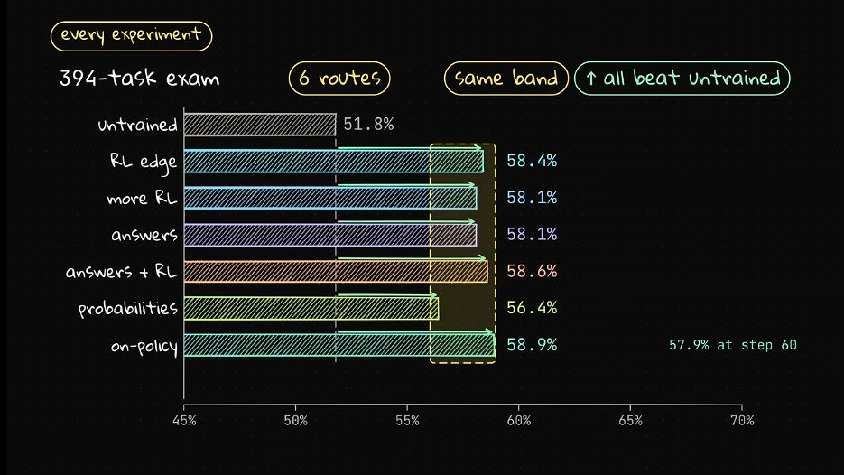
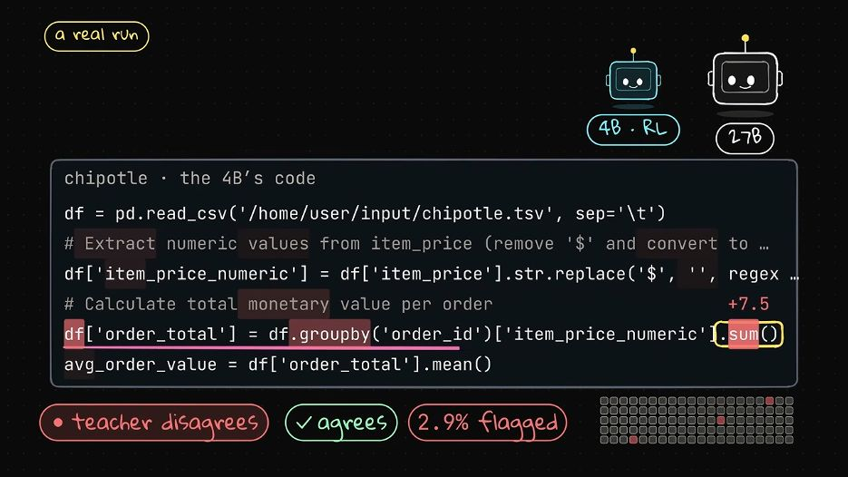
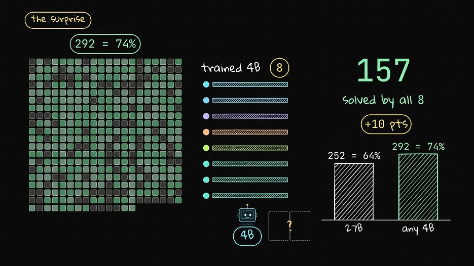

[Source video](https://www.youtube.com/watch?v=hOitZIkMT2Y) · Prompt Engineering, October 29, 2026 · 23 minutes 15 seconds. **Core route:** read the results, the three methods, and the final decision guide. Mathematics and implementation notes are optional; no training run or exercises are required.

**Main result:** PE made his 4B agent imitate a 27B teacher in three different ways. Accuracy stayed in a roughly 56–59% band, versus 58.4% for the starting RL checkpoint and 64.0% for the teacher. Answer distillation nevertheless reduced average generated tokens from **2,007 to 1,401**, about **30.2%**. Training changed execution habits more clearly than aggregate correctness.

# Experiment setup and exact results

The student is **Qwen3.5-4B**; the teacher is **Qwen3.5-27B**, with the repository identifying its evaluated teacher as an FP8 model. The tasks come from SmolDataEnvs: inspect real data files, write and execute code in a sandbox, and save an answer that a strict checker can verify. The exam has **394 held-out tasks**, including **87 on datasets absent from training**. The repository describes evaluation as greedy, agent-mode, strict-checker pass@1.

**Every distillation run starts from the best RL checkpoint at 58.4%.** Thus the relevant question is whether a teacher improves an already RL-trained student. The experiment does not compare each method independently from the original 51.8% model. Two DGX Sparks separate teacher inference from student training. [Video setup, 2:21](https://www.youtube.com/watch?v=hOitZIkMT2Y&t=141s) · [Starting checkpoint, 8:03](https://www.youtube.com/watch?v=hOitZIkMT2Y&t=483s) · [Repository](https://github.com/PromtEngineer/smoldataenvs-grpo-spark/blob/main/README.md)

| Route | Exam pass@1 | Change from 58.4% RL | What PE found |
| --- | ---: | ---: | --- |
| Original 4B before these training runs | 51.8% | −6.6 percentage points | Baseline |
| RL on selected edge tasks | 58.4% | 0.0 | Starting point for distillation |
| More RL | 58.1% | −0.3 | Additional RL did not break the plateau |
| Teacher answers | 58.1% | −0.3 | Similar correctness with shorter generated trajectories |
| Teacher answers followed by RL | 58.6% | +0.2 | Best reported unseen-dataset subgroup result |
| Teacher probabilities | 56.4% | −2.0 | Close token agreement did not yield higher exam accuracy |
| On-policy distillation at step 20 | 58.9% | +0.5 | Best observed 4B score |
| On-policy distillation at step 60 | 57.9% | −0.5 | Longer training gave back the small gain |
| 27B teacher | 64.0% | +5.6 | Larger-model reference |

Scores are PE’s reported measurements. The exact distillation values appear in his [comparison chart, 16:42–17:20](https://www.youtube.com/watch?v=hOitZIkMT2Y&t=1002s). A 0.5 percentage point change on 394 tasks is approximately two tasks. PE calls the trained outcomes statistical ties; that wording does not establish that all methods are equivalent under other budgets or datasets.



PE’s source chart at [17:20](https://www.youtube.com/watch?v=hOitZIkMT2Y&t=1040s). Its horizontal axis begins at 45%, magnifying the visual differences. The rebuilt comparison below uses a zero baseline.


# Why distillation might overcome sparse RL feedback

GRPO reinforces attempts that outperform the average of their sampled group. If four attempts all fail, their rewards are identical and none has a positive relative advantage. All-success groups have the same problem. In PE’s earlier run, selecting tasks the model solved only sometimes helped produce useful reward contrast. [Video, 3:35](https://www.youtube.com/watch?v=hOitZIkMT2Y&t=215s)

A schematic group-relative advantage is:

```math
A_i=\frac{r_i-\bar r}{\sigma_r+\varepsilon}
```

When all rewards match, this reward-derived advantage is zero. Other regularization terms can still update parameters. Distillation supplies a different learning signal: tokens selected or scored by a teacher can provide supervision even when the student has never completed the task successfully.

The methods differ along **two independent axes**:

| Method | Who generates the training path | Supervision |
| --- | --- | --- |
| Answer distillation | Teacher | The selected teacher tokens |
| Probability distillation | Teacher in PE’s experiment | A distribution over possible next tokens |
| On-policy distillation | Current student | Teacher probabilities at the student’s own prefixes |
| GRPO baseline | Current student | Relative final task reward |

A **trajectory** includes the agent’s generated text, tool calls, and the observations that become subsequent context. **On-policy** means the current student generates the attempts used to train it. It does not merely mean that training happens live.

## Follow one training update

Select a method and advance through the four stages. This is a schematic teaching animation, not a recording of PE’s training software.


# Method 1 learns from successful teacher answers

## What the student learns

The teacher demonstrates complete successful workflows. The student receives those workflows as supervised training examples and learns to generate their assistant tokens. In this experiment, “answers” means **successful agent transcripts**, including code and tool use, rather than only the final numeric answer. [Method 1, 8:37](https://www.youtube.com/watch?v=hOitZIkMT2Y&t=517s)

PE ran the teacher on **2,000 training tasks**, retained roughly **1,400 transcripts** that passed the strict checker, and fine-tuned the RL-trained 4B student on them. His data-building code also filters incomplete episodes and handles malformed tool calls. User messages and tool responses remain context; the training mask places loss on appropriate assistant-generated tokens. [Data builder](https://github.com/PromtEngineer/smoldataenvs-grpo-spark/blob/main/scripts/build_sft_27b.py) · [Training mask](https://github.com/PromtEngineer/smoldataenvs-grpo-spark/blob/main/train_sft_agent.py)

## How the update works

At a teacher-produced prefix, increase the probability of the next demonstrated token. A schematic loss is:

```math
\mathcal L_{\mathrm{answer}}
=-\sum_{t\in\mathcal A}\log p_\theta(y_t^T\mid h_t^T)
```

Here, the superscript T denotes a teacher demonstration, h is its full context, and the set A contains supervised assistant-token positions. The teacher remains fixed; only student parameters change.

For example, a successful transcript might teach the sequence “inspect columns, aggregate sales by publisher, choose the maximum, save the publisher name.” Copying that workflow can eliminate aimless inspection even without adding new data-analysis capabilities. This example is explanatory.

## PE results

**58.1% exam accuracy**, compared with 58.4% for the RL starting point. Further RL after distillation reached **58.6%**. The unseen-dataset subgroup scored **57.5%** after answer distillation and **62.1%** after distillation followed by RL; the starting RL model had **58.6%** on that subgroup. The repository’s p = 0.04 for the 62.1% result compares with the original untrained model, not with the RL checkpoint. The subgroup contains only 87 tasks. [Repository results](https://github.com/PromtEngineer/smoldataenvs-grpo-spark/blob/main/README.md)

The clearest operational gain was **2,007 → 1,401 generated tokens per task**:

```math
\frac{2007-1401}{2007}\times100\%\approx30.2\%
```

PE describes this as shorter, faster, and cheaper. The directly reported quantity here is generated-token volume. End-to-end latency and total cost also depend on tool execution, input tokens, serving throughput, and billing. [Efficiency discussion, 9:21](https://www.youtube.com/watch?v=hOitZIkMT2Y&t=561s)

## When this is a useful starting point

Use teacher-answer SFT when you can obtain reliable demonstrations and want a simple first experiment. It transfers across tokenizers because you train on text rendered with the student’s own tokenizer. Its weakness is **exposure bias**: a student mistake at deployment can lead to a context absent from the teacher’s clean demonstrations.

# Method 2 learns the teacher probability distribution

## What changes relative to answer distillation

A teacher produces a probability distribution before choosing its next token. A single transcript reveals only the choice it made. Probability distillation also exposes alternatives.

PE illustrates this with code-inspection choices: roughly **59% for .head, 36% for .shape, and 4% for .info**. These are useful alternative actions; the transcript retains only the selected one. [Conceptual explanation, 5:19](https://www.youtube.com/watch?v=hOitZIkMT2Y&t=319s)

For the experiment, he rescored the same roughly 1,400 successful transcripts, nearly **five million tokens**, saving the teacher’s **top 20 next-token choices and their probabilities** at each position. The student then trained against those distributions. “Full probabilities” in the narration should therefore be understood as a top-20 approximation, not an exported full-vocabulary vector. [Method 2, 11:00](https://www.youtube.com/watch?v=hOitZIkMT2Y&t=660s)

## How the update works

A standard explanatory objective minimizes forward KL at teacher contexts:

```math
\mathcal L_{\mathrm{soft}}
=\sum_{t\in\mathcal A}
D_{\mathrm{KL}}\!\left(p_T(\cdot\mid h_t^T)\,\Vert\,p_\theta(\cdot\mid h_t^T)\right)
```

This rewards agreement across alternatives, rather than only on one demonstrated token. PE’s top-20 storage requires additional choices about renormalization or omitted probability mass; this equation explains the idealized objective rather than asserting his exact implementation.

Classic distillation can soften distributions using temperature:

```math
p_T(v;\tau)=\frac{\exp(z_v/\tau)}{\sum_u\exp(z_u/\tau)}
```

Higher temperature makes low-probability alternatives more visible. This is background from [Hinton, Vinyals, and Dean](https://arxiv.org/html/1503.02531v1), not evidence that PE swept temperature in this experiment. For a fixed prefix, sampling teacher tokens estimates the same cross-entropy objective in expectation; filtered successful demonstrations and a single finite sample are different from exhaustive distribution matching.

## Hard and soft targets

The interactive example below uses illustrative logits for three candidate tokens. The probabilities are invented for teaching; they are not PE’s measurements. Increase temperature to see the alternatives become more prominent.


## PE results and diagnosis

The probability-distilled student scored **56.4%** on the exam. PE reports about **96% agreement with the teacher’s top token during training**. These measure different things: local token agreement on training contexts versus successful execution of an entire held-out task.

He inspected more than **4,000 teacher-token positions**. On roughly three quarters, the teacher assigned more than 99% probability to one choice. The teacher’s top choice matched the recorded transcript token about 96% of the time; only about **2.6%** of inspected positions were substantially uncertain, often over harmless wording such as “data” versus “dataset.” This second 96% statistic describes the teacher’s rescoring of transcripts, not student exam accuracy. [Diagnosis, 11:30–13:06](https://www.youtube.com/watch?v=hOitZIkMT2Y&t=690s)

**PE’s interpretation:** a highly confident coding teacher left little additional useful information for probability matching beyond the written demonstrations. **What the experiment establishes:** this particular probability run did not outperform answer imitation or the RL checkpoint. It does not establish that soft targets are generally useless. A few low-probability alternatives can matter disproportionately at a consequential branching decision.

Direct token-distribution matching assumes aligned token identities. Verify vocabulary IDs, special tokens, and templates, rather than assuming two models match because they share a family name. Cross-tokenizer distillation requires extra alignment machinery; PE’s direct recipe assumes identical tokenization.

# Method 3 scores attempts generated by the student

## What changes relative to both earlier methods

The student generates its own attempt, including mistakes. The teacher scores the student’s chosen tokens **conditioned on exactly the context the student reached**. Training therefore addresses contexts absent from clean teacher demonstrations. [Method 3, 13:30](https://www.youtube.com/watch?v=hOitZIkMT2Y&t=810s)

PE ran student rollouts on one Spark and teacher scoring on the second. The learning cycle is:

1. Sample a student attempt in the sandbox.

2. Preserve its prompts, generated assistant tokens, tool calls, and observations.

3. Ask the fixed teacher for probabilities of those student tokens at their matching prefixes.

4. Construct token-level training signals, update the student, and collect fresh rollouts.

“Grades every token” is a metaphor for conditional likelihood feedback. It does not imply that the teacher executes a correctness test for each token.

## A mathematical connection to reverse KL

One common on-policy formulation uses the sampled log-ratio signal:

```math
a_t=\log p_T(y_t\mid h_t)-\log p_\theta(y_t\mid h_t),
\qquad y_t\sim p_\theta(\cdot\mid h_t)
```

At a fixed student-visited prefix:

```math
\mathbb E_{y_t\sim p_\theta}[a_t]
=-D_{\mathrm{KL}}\!\left(p_\theta(\cdot\mid h_t)\,\Vert\,p_T(\cdot\mid h_t)\right)
```

This connects teacher scoring to a policy-gradient-style update. It is the formulation described by [Thinking Machines](https://thinkingmachines.ai/blog/on-policy-distillation/), offered here as explanatory theory rather than a code audit of PE’s on-policy trainer. A sampled log ratio can have either sign; only the expected KL has guaranteed nonnegativity.

## The Chipotle example

PE shows a student calculating average order value. The teacher agrees with most of the code but strongly disagrees at a few positions, including a token around the aggregation line. The student produces **18.81** instead of the checker’s **21.39**. About **2.9%** of tokens are flagged in the displayed example. [Real example, 14:12](https://www.youtube.com/watch?v=hOitZIkMT2Y&t=852s)



Source frame at [14:50](https://www.youtube.com/watch?v=hOitZIkMT2Y&t=890s). Red shading marks teacher disagreement. It can identify a promising location to inspect; it is not a proof of causal blame. Once a mistaken prefix has been established, even a wrong final answer can be locally predictable.

## PE results and failure modes

The teacher–student training gap dropped quickly over the first **20 steps**, then flattened. At **step 20**, the student scored **58.9%**, the best observed 4B checkpoint. By **step 60**, it scored **57.9%**. Lower divergence during training did not deliver steadily higher exam success. [Results, 15:14](https://www.youtube.com/watch?v=hOitZIkMT2Y&t=914s)

The behavioral changes were mixed:

| Example | Earlier behavior | On-policy behavior | Lesson |
| --- | --- | --- | --- |
| Iris count question | RL and answer-distilled models output “50 50 50” | Outputs the required single number, “50” | Supervision can improve adherence to strict output requirements |
| Temperature-data task | Teacher finishes in seven steps | Longer-trained student repeatedly rechecks and exhausts the 12-turn budget without an answer | More training can worsen completion under an execution budget |

The narration’s dataset name in the second example is unclear in automatic captions; the relevant finding is the repeated checking and missing final answer. PE recommends stopping when improvement flattens. In practice, choose checkpoints using a separate validation set and evaluate the locked choice once on the final exam; choosing repeatedly on the exam can bias the reported best result upward.

# Similar scores can hide different capabilities

PE compared **eight trained 4B checkpoints** task by task:

- **157 of 394** tasks were solved by all eight.

- **292 of 394**, about **74.1%**, were solved by at least one.

- Only **seven tasks** solved by the teacher were unsolved by every checkpoint in that set.

These results describe complementary successes across models. They do not demonstrate a deployable 74% agent: selecting the right checkpoint or answer is an additional problem. They also do not prove that any single 4B checkpoint contains every capability in the union. [Task overlap, 17:27](https://www.youtube.com/watch?v=hOitZIkMT2Y&t=1047s)



PE’s overlap visualization at [18:28](https://www.youtube.com/watch?v=hOitZIkMT2Y&t=1108s). “Any 4B” is an oracle-style union across checkpoints, whereas the teacher’s 64% is one evaluated model.

In a separate experiment on **999 training tasks**, the original 4B model had **62.3% pass@1** and **72.9% pass@4**. Pass@4 asks whether at least one of four attempts succeeds. It reveals useful sampled successes and suggests a reliability opportunity. It is neither a guarantee of attainable pass@1 after training nor a hard capability ceiling. It also uses a different task set from the 394-task exam, so 62.3% must not be compared directly with 51.8%. [Four-attempt test, 19:07](https://www.youtube.com/watch?v=hOitZIkMT2Y&t=1147s) · [Repository figures](https://github.com/PromtEngineer/smoldataenvs-grpo-spark/blob/main/README.md)

**The deeper distinction:** a training method can redistribute which tasks succeed while leaving average accuracy almost fixed. Measure per-task transitions, completion rate, tool-call count, token volume, and subgroup generalization alongside the headline score. PE suspects student size contributes to the plateau and proposes testing 2B and 9B models; that size explanation remains a hypothesis in this video.

# Choosing a method for a small local agent

PE recommends starting with a four-attempt diagnostic and then teacher-answer training. He reserves on-policy distillation for cases where strict task rewards leave the student without useful feedback. [Recommendations, 21:21](https://www.youtube.com/watch?v=hOitZIkMT2Y&t=1281s)

| Situation | Useful first move | Evidence to inspect |
| --- | --- | --- |
| You need cleaner execution and have correct demonstrations | Answer distillation | Pass@1, generated tokens, completion rate |
| You suspect teacher uncertainty contains meaningful alternatives | Inspect a small probability sample before a full probability run | Entropy and disagreement at consequential code choices |
| The student repeatedly reaches mistaken prefixes or all-fail reward groups | Try on-policy teacher scoring | Validation success, teacher–student divergence, turn-budget failures |
| Different checkpoints solve different tasks | Investigate verification or routing | Held-out answer-selection accuracy and additional compute |
| All methods plateau under one setup | Test a specific alternative explanation | Student size, data coverage, initialization, or execution budget |

## A reusable implementation outline

These are conceptual recipes, not runnable reproductions:

```python
# 1. Answer distillation
for task in training_tasks:
    trace = run_agent(teacher, task)
    if strict_checker(trace.final_answer, task.answer_key):
        demonstrations.append(trace)
student.sft(demonstrations, loss_on="assistant_generated_tokens")

# 2. Probability distillation
for trace in demonstrations:
    targets = teacher.score_next_tokens(trace.prefixes, top_k=20)
    student.match_distributions(trace, targets)

# 3. On-policy distillation
for update in training_budget:
    traces = run_agent(student, sample(training_tasks))
    teacher_logp = teacher.score_chosen_tokens(traces)
    student_logp = student.score_chosen_tokens(traces)
    advantage = stop_gradient(teacher_logp - student_logp)
    student.policy_update(traces, per_token_advantage=advantage)
```

Each operation stands for a real training subsystem. Correct masking, token alignment, sampling probabilities, and an appropriate policy-loss implementation matter; a raw likelihood difference is not by itself a complete optimizer.

The public repository provides the answer-data builder, assistant-token masking, sandbox, strict checker, and evaluation harness. Its inspected main branch does not yet expose a named probability scorer or on-policy trainer, although PE says he will publish those. Use the linked SFT code as a concrete reference; treat the final two recipes above as schematics. [Repository](https://github.com/PromtEngineer/smoldataenvs-grpo-spark)

## Hardware details that affect correctness

PE reports that probability buffers pushed his 128 GB Spark beyond 110 GB and stalled the run. He lowered the vLLM memory setting to **0.45**, chunked scoring, and used **eight rows per batch**. The automatic captions render the chunk length ambiguously, so an exact chunk size is not prescribed here. These are observations about his hardware and software setup. [Practical tips, 20:24](https://www.youtube.com/watch?v=hOitZIkMT2Y&t=1224s)

A less obvious issue is **training–serving mismatch**. The repository reports that kernels and repetition penalties can make rollout probabilities differ from trainer probabilities, distorting RL importance weights. Matching tokenizer, chat template, model settings, and likelihood computation is part of training correctness. [Repository hardware lessons](https://github.com/PromtEngineer/smoldataenvs-grpo-spark/blob/main/README.md)

# Three quick understanding checks

**1. Why is on-policy distillation different from probability distillation in this video?**

Both use teacher probabilities. The distinction is whose prefixes the teacher scores: teacher demonstrations for probability distillation, current student attempts for on-policy distillation.

**2. Why can 96% token agreement coexist with 56.4% task accuracy?**

Token agreement counts many easy, predictable positions. A few consequential code or output errors can fail a complete task; the two metrics also use different contexts and datasets.

**3. What would turn the 74% checkpoint union into a useful system?**

A verifier or router that can select successful answers on new tasks. The union alone assumes access to the answer key after attempts are complete.

# What to retain

**Answer distillation copies successful execution habits. Probability distillation adds supervision about alternatives. On-policy distillation moves that supervision to contexts the student actually visits.** These are different interventions, and their value depends on the task and initialization.

For PE’s setup, the practical outcome is a student that can generate shorter workflows at about the same accuracy. The plateau does not establish a universal 4B limit: one teacher–student pair, one task family, finite training, strict formatting, and a 12-turn execution budget all constrain the conclusion.

# What to explore next

A useful follow-up is to distinguish **knowledge, selection, and execution**: compare a larger student, several attempts with an independent verifier, and the short answer-distilled student under the same inference budget. This would test whether extra parameters, better answer selection, or cleaner execution produces the most useful gain. It is a proposed experiment, not a result from PE’s video.

The conceptual bridge from CIFAR-10 distillation is straightforward: soft-label matching becomes next-token distribution matching; an agent then adds a new complication, because its own generated actions change the future contexts on which it must perform.

# Sources and scope

The video is the source for PE’s three experiments and practical recommendations. Its available transcript runs from the opening through the closing at 23:09, within the 23:15 video. Source frames support the exact comparison and overlap figures. The repository corroborates the benchmark, model names, SFT route, subgroup scores, and selected implementation details. Measurements are PE’s; these training runs have not been independently replicated.

1. [Prompt Engineering video](https://www.youtube.com/watch?v=hOitZIkMT2Y): method overview at 4:40, answers at 8:37, probabilities at 11:00, on-policy at 13:30, comparison at 16:42, overlap at 17:27, pass@4 at 19:07, practical advice at 20:24.

2. [Experiment repository](https://github.com/PromtEngineer/smoldataenvs-grpo-spark): README, data builder, training mask, and evaluation code. Code availability can differ from the video’s announced publication plan.

3. [Hinton, Vinyals, and Dean, 2015](https://arxiv.org/html/1503.02531v1): background on soft targets and temperature.

4. [Thinking Machines, On-Policy Distillation](https://thinkingmachines.ai/blog/on-policy-distillation/): background for the sampled reverse-KL formulation, distinct from PE’s measured runs.

5. [Qwen3 Technical Report](https://arxiv.org/abs/2505.09388): PE’s cited background for larger-scale distillation. Its math-benchmark and compute results are separate from this desktop data-agent experiment.

All new animations, schematic equations, and worked examples are teaching additions. Screenshots are excerpts from PE’s video, reproduced for explanation.
